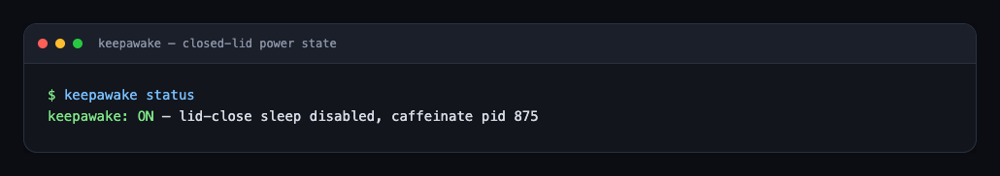

# keepawake

`keepawake` is a small macOS-only power-state helper for deliberate closed-lid work. It combines `pmset disablesleep` with a managed `caffeinate -i` process so a Mac can continue running while the lid is closed.

This repository is the standalone public distribution of the utility.

## Showcase



A real `keepawake status` result from a machine with the helper on.

## Requirements

- macOS
- Go 1.26 or newer to build from source
- Administrator approval for commands that change the system sleep setting

## Install

From a checkout of this repository:

```sh
make install
export PATH="$HOME/.local/bin:$PATH"
```

The installer places the binary at `~/.local/bin/keepawake`. Add that directory to your shell configuration if it is not already on `PATH`.

## Usage

```sh
keepawake          # inspect the combined system and process state (default: status)
keepawake status   # inspect the combined system and process state
keepawake on       # enable closed-lid awake behavior
keepawake repair   # reconcile a partial state toward ON
keepawake off      # restore normal lid-close sleep and stop caffeinate
```

With no verb, `keepawake` defaults to `status` (read-only). `start` and `stop` are accepted as aliases for `on` and `off`.

`status` is read-only and reports `ON`, `OFF`, or `PARTIAL`. The `on`, `off`, and some `repair` paths invoke `sudo pmset`, so macOS may ask for administrator approval.

## Safety model

- The utility manages both `pmset -a disablesleep 1` and a persistent, session-detached `/usr/bin/caffeinate -i` process.
- `keepawake off` is authoritative: it resets `pmset -a disablesleep 0`, verifies the change took effect, stops any verified managed `caffeinate`, and clears stale metadata so `keepawake status` returns `OFF`.
- Its PID record lives under `~/.local/state/keepawake/caffeinate.pid` (or `$XDG_STATE_HOME/keepawake/caffeinate.pid`) so it stays consistent across shells and temp cleanups, while still reading and cleaning up legacy temp-dir records on upgrade.
- Its PID record stores the process start identity as well as the PID. `off` refuses to signal a reused or unrelated process.
- Commands are serialized with a lock, and failed transitions attempt to roll back the state they introduced.
- Set `KEEPAWAKE_PIDFILE` to override the PID-record path, which is useful for isolated tests.

Always run `keepawake off` when finished. A disabled sleep setting is persistent, and a closed laptop has less effective airflow.

## Development

```sh
make verify
make build
```

`make verify` runs formatting, race-enabled tests with coverage, and `go vet`. The command is intentionally macOS-specific even though the unit tests use a fake platform for most lifecycle coverage.

## License

[MIT](LICENSE)
